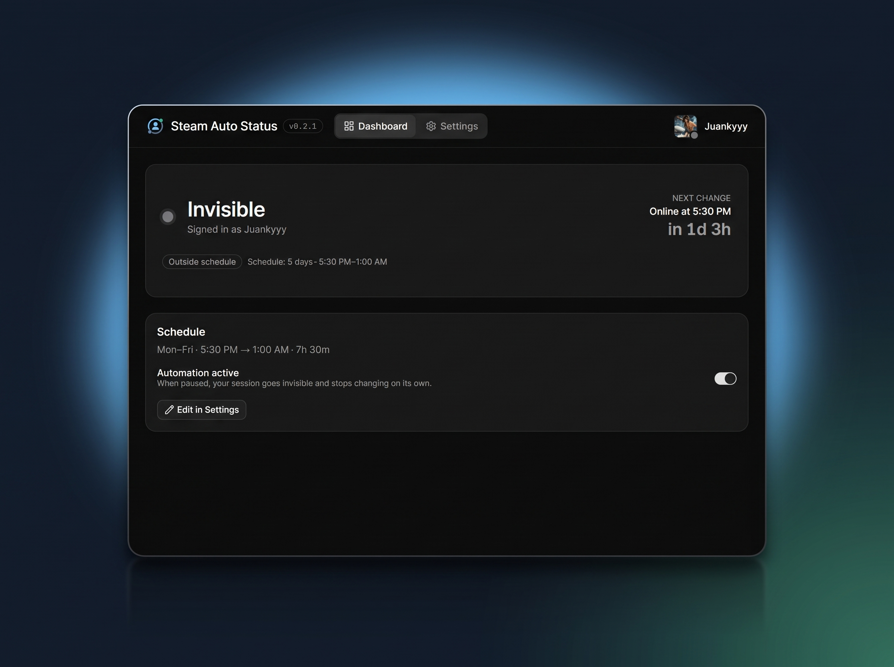

  <picture>
    <source media="(prefers-color-scheme: dark)" srcset="assets/logo-lockup-dark.png">
    <source media="(prefers-color-scheme: light)" srcset="assets/logo-lockup.png">
    
  </picture>

<strong>Online when you want. Invisible when you don't.</strong>

  
  
  
  
  
  

Steam Auto Status keeps your Steam presence on your schedule: **Online** during the hours
you choose, **Invisible** the rest of the time. It's a small Windows tray app that lives
quietly in the background, so you don't have to remember to appear online before work or
to go invisible before bed.

## 📸 Screenshots

  

## ✨ Features

- **Schedule-driven presence**: Online inside your weekly window and Invisible outside it.
  Pick the days and the start/end time, including overnight windows (default: Monday–Friday,
  17:30 → 01:00).
- **No login, no session**: The app doesn't sign in, store a token or create a second Steam
  session. It asks the official client that is already open to change its own status, using
  the same local commands as the Friends → Status menu.
- **Your Steam client stays yours**: The app only switches Online/Invisible. It never
  launches games, never signs the client out and never touches your credentials.
- **Requires Steam open**: The status can only be applied while the Steam client is running
  and signed in. If it is closed, you are already Offline; the app warns you and applies the
  schedule as soon as Steam starts.
- **Tray-first, panel when you want it**: Current status and next change at a glance,
  one-click overrides from the tray menu ("Online for 30 min", "Invisible now",
  pause/resume), and a settings window for schedule, startup and notifications. The tray
  icon doubles as a status light: green online, grey invisible/closed.
- **Light on resources**: One small native shell; the WebView processes are released when you
  close the window. Built to stay open 24/7.
- **Spanish and English**: Switch language at runtime; the panel, tray menu, tooltip and
  notifications follow the same setting. On first run it matches your Windows language.
- **Local by default**: Settings and logs live in one folder under `Documents` (configurable
  from the panel). The app needs no network: it only talks to the local Steam client.

## 🚀 Getting started

### 1. Download & install

Grab **`steam-auto-status_X.Y.Z_x64-setup.exe`** from the
[**latest release**](https://github.com/Juankyyy/steam-auto-status/releases/latest) and
run it. Per-user install: no admin rights needed.

> ⚠️ **"Windows protected your PC"?** The app isn't code-signed, so SmartScreen warns
> about an unknown publisher. Click **More info → Run anyway**. The full source is in this
> repository, so you can inspect (or build) it yourself.

### 2. Keep Steam open

No login and no QR code. Start Steam normally and leave it running (the tray is enough).
The app only needs the client open and signed in; it will switch Online/Invisible for you.

### 3. Forget about it

The app lives in the tray and switches your presence on schedule. Open the panel any time
to adjust hours, weekdays, notifications or to pause the automation.

## ⚙️ How it works

Steam has no native schedule for presence, but its client understands local `steam://`
commands. The app sends the same command the Friends → Status menu uses:

- `steam://friends/status/online`
- `steam://friends/status/invisible`

There is no separate session, no refresh token and no password. The app checks that
`steam.exe` is running, sends the command, and records what it sent. Outside your window it
asks for Invisible (not Offline: Offline would sign you out of friends and chat). If Steam
is closed, your status is already Offline; the app waits for the client and applies the
schedule when it appears.

The local command has no reply, so the app cannot read Steam's real presence. If you change
your status by hand, it is not corrected until the next schedule transition, the next app or
Steam start, or **Reapply now**; the app deliberately does not re-send the command every few
seconds to fight manual changes.

## 🔐 Your data

- Everything is stored **locally** in `Documents\steam-auto-status\` (config and logs),
  never in AppData. The folder is configurable from the settings panel.
- The app stores **no credentials and no token** and needs no network connection.
- If you used an older version, it may have left `auth.json`, `profile.json` and
  `steam-data/` behind. This version never reads them; you can delete them from
  **Settings › Steam client**. Deleting the files does not invalidate the old token, so
  also revoke it in Steam (Manage Steam devices).
- Uninstalling **keeps your data**; delete the folder manually if you want a clean slate.

## ❓ FAQ & troubleshooting

<strong>It didn't change my status</strong>

Check three things:

1. **Steam is open and signed in**: the panel header should say "Steam open". If it says
   "Steam closed", open Steam and wait a few seconds; the app applies the schedule when it
   appears.
2. **The app is running**: look for the tray icon.
3. **The schedule covers the current time**: panel → Schedule (overnight windows included).

If another device is signed in and Online (the mobile app, a Steam Deck, the web chat),
friends may still see you Online even when the desktop client is Invisible. The app can only
control the local client. Live logs are in `Documents\steam-auto-status\logs\`.

<strong>The panel stays loading, or something looks stuck</strong>

Close the app from the tray and open it again. If it persists, copy a diagnostic from
**Settings › Data & logs › Copy diagnostics** (version, client state and the latest log
lines) and [open an issue](https://github.com/Juankyyy/steam-auto-status/issues) with it.

<strong>Can it change my status while Steam is closed?</strong>

No. Without a session of its own, the app needs the official Steam client running. If Steam
is closed you are already Offline; the app warns you and applies the schedule as soon as the
client starts. This is the deliberate trade-off for not logging in or storing a token.

<strong>How do I switch Steam accounts?</strong>

Just switch accounts in Steam as usual. The app doesn't know or store the account; it always
controls whichever account is signed into the local client.

<strong>How do I close it completely?</strong>

Tray icon → **Quit**. If **Start with Windows** is enabled, turn it off first or the app
will come back on reboot.

<strong>How do I update?</strong>

Download the new installer from the
[latest release](https://github.com/Juankyyy/steam-auto-status/releases/latest) and run it
on top of your current version: your config and logs are kept. If you come from a version
that stored a Steam token, delete the old session files from **Settings › Steam client** and
revoke the token in Steam (Manage Steam devices).

<strong>Does my PC need to stay on? Does Steam?</strong>

Yes to both: the app and the official Steam client must be running to update your status.
Enable **Start with Windows** for the app, and Steam's own "Run Steam when my computer
starts" option if you want the schedule to apply from boot.

<strong>Will this get me banned?</strong>

The app doesn't touch games or inject into any process. It uses the client's own local
`steam://friends/status/*` commands, the same ones the Friends → Status menu uses, and it
does not log in or create a second session. That removes the login pattern that can look
suspicious to Steam, but automating your own status is still a grey area of Steam's terms:
use it at your own risk.

<strong>What languages are available?</strong>

The interface ships in English and Spanish; switch it any time in **Settings › Language**
(it applies instantly to the panel, the tray menu, the tooltip and notifications). On first
run the app follows your Windows language.

## 🛠️ For developers

Project structure, building and releases

| Folder | Contents |
|---|---|
| `src-tauri/` | Native app (Rust/Tauri 2): tray, window, schedule, config, logs and Steam client control |
| `ui/` | Interface (React + TypeScript + Tailwind + shadcn/ui) |
| `assets/` | Visual identity and the screenshots used in this README |
| `scripts/` | Build helpers: version bump and installer rename |

Requirements: Node.js 22 or newer and Rust (rustup) + MSVC Build Tools.

| Command | What it does |
|---|---|
| `npm install` | Installs the workspace dependencies (`ui`) |
| `npm run dev` | Opens the app with Vite + Tauri (controls the local Steam client) |
| `npm run build` | Full NSIS installer → `src-tauri/target/release/bundle/nsis/` |
| `npm run typecheck -w ui` | Types only, no output |
| `npm run lint -w ui` | oxlint over the UI |
| `cargo check --manifest-path src-tauri/Cargo.toml` | Checks the Rust app |
| `cargo test --manifest-path src-tauri/Cargo.toml` | Unit tests for config and schedule |

The build renames the installer to `steam-auto-status_X.Y.Z_x64-setup.exe`. There is no
bundled Node runtime: the app is a single native executable (plus WebView2, already present
on Windows 10/11).

**Releases:** push a `vX.Y.Z` tag from `main`. GitHub Actions builds everything on Windows
and publishes the release with the installer attached.

Design decisions and internals are documented in [SPEC.md](SPEC.md) (Spanish), and
[AGENTS.md](AGENTS.md) covers the working conventions.

## 🤝 Contributing

Bug reports and ideas are welcome in
[Issues](https://github.com/Juankyyy/steam-auto-status/issues). If you send a change, keep
the conventions: English code, comments and commits; user-facing texts through the bilingual
dictionary in `ui/src/lib/i18n.ts`; and a look at [SPEC.md](SPEC.md) before touching
behaviour.

## 📄 License

[GPL-3.0](LICENSE) — free to use, study, share and improve.

---

⭐ <strong>Finding it useful?</strong> A star helps other people discover the project.

